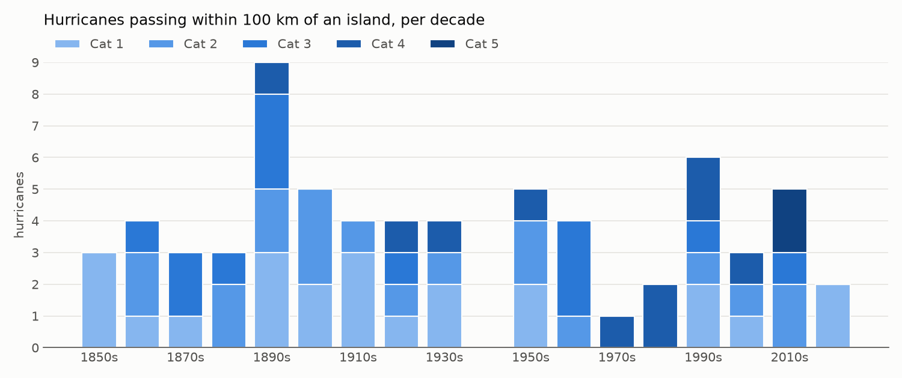
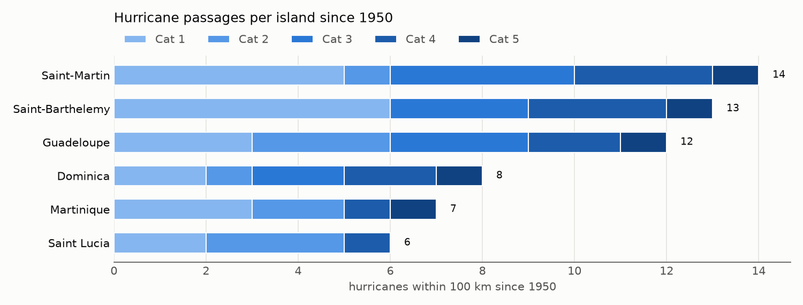

# Antilles Hurricane Warehouse

[](https://github.com/tomtessondev/antilles-hurricane-warehouse/actions/workflows/ci.yml)
[](https://github.com/tomtessondev/antilles-hurricane-warehouse/actions/workflows/daily.yml)

Every hurricane that passed near the Antilles since 1851, and what the islands' weather did
on those days since 1940: NOAA's best tracks and a weather reanalysis loaded into
BigQuery, modelled with dbt, kept far inside the free tier, and run every day from GitHub
Actions without a single stored key.





The six islands: Guadeloupe, Martinique, Saint-Barthélemy, Saint-Martin, Dominica and
Saint Lucia. A *passage* is a storm whose track came within 100 km of an island's point;
its category is the Saffir-Simpson category of its strongest wind within that radius.

Documentation of every model, column and test, with the lineage graph:
**[dbt docs](https://tomtessondev.github.io/antilles-hurricane-warehouse/)**.

## Architecture

```text
NOAA IBTrACS (North Atlantic CSV, ~60 MB) ──┐
                                            ├─ hurricane-load (Python) ─► raw.tracks
Open-Meteo archive (ERA5, daily, 1940→) ────┘                          ► raw.island_weather
                                                                              │ dbt
   staging.stg_tracks          (table, partitioned by season, clustered by storm)
   staging.stg_island_weather  (incremental, partitioned by month, clustered by island)
   staging.islands             (seed: the six island points)
           │
   intermediate.int_track_points_near_islands   (BigQuery GIS: ST_DWITHIN 100 km)
           │
   marts.fct_storm_passages      one row per storm and island
   marts.agg_passages_by_decade  passages per island, decade and category
   marts.fct_current_season      the latest season's passages
   marts.fct_passage_weather     the island's rain and wind the day before, of and after
```

GitHub Actions runs it all: `ci.yml` on every pull request, `daily.yml` at 06:00 UTC
(load, then `dbt build`), `docs.yml` on `main` (dbt docs to GitHub Pages).

## Sources

- **[IBTrACS v04r01](https://www.ncei.noaa.gov/products/international-best-track-archive)**,
  NOAA NCEI: every North Atlantic storm since 1851, a position every 3 or 6 hours. The
  BigQuery public copy (`bigquery-public-data.noaa_hurricanes`) stops at the 2023 season,
  so the official file is loaded instead. Wind and pressure come from the US agency (the
  reference in this basin), the WMO value filling the gaps; spur tracks are left out, and
  the current season's storms are kept while NOAA still marks them provisional.
- **[Open-Meteo historical weather](https://open-meteo.com/en/docs/historical-weather-api)**
  (ERA5 reanalysis, CC BY 4.0): daily rain, maximum wind and gusts at each island's point,
  in UTC days like the track positions. A reanalysis smooths extremes: it shows that a day
  was stormy, not the gust a station measured.

## Cost control

BigQuery bills by bytes read. The whole project bills a few gigabytes a month, out
of the free terabyte, and four guards keep it there:

1. **Partitioning and clustering.** Tracks are partitioned by season and clustered by
   storm, weather by month and clustered by island: models that filter on a season, a
   storm, a month or an island read only those blocks. Weather is incremental (the last
   ten days are reloaded and merged, the archive revises them); tracks are rebuilt whole
   every day, because NOAA revises past seasons and the whole history is 8 MB.
2. **A cap on every query.** The dbt profile sets `maximum_bytes_billed` to 1 GB (a test
   checks it): a query that would read more fails instead of billing.
3. **A dry run in CI.** Every pull request compiles the models and dry-runs each one (a
   dry run plans the query and reports the bytes it would read, for free); any model above
   200 MB fails the check.
4. **A budget.** 5 USD a month on the billing account, with e-mail alerts at 50, 90 and
   100 %.

Measured on the real project (`INFORMATION_SCHEMA.JOBS_BY_PROJECT`):

| Run | Queries | Read | Billed |
| --- | ---: | ---: | ---: |
| First build (all history) | 69 | 82 MB | 459 MB |
| Daily build | 26 | 33 MB | 189 MB |
| Largest model, dry run | 1 | 10 MB | 0 |

BigQuery bills at least 10 MB per query, which is why billed exceeds read. Thirty daily
runs come to under 6 GB a month, under 1 % of the free terabyte; storage (under 50 MB)
stays inside the free 10 GB.

## Keyless CI

There is no service account key anywhere. GitHub Actions asks GitHub for an OIDC token,
and Google's Workload Identity Federation exchanges it for short-lived credentials of the
`dbt-runner` service account, but only for workflows of this repository (Terraform pins
the `repository` claim). `dbt-runner` can run BigQuery jobs and write the four datasets,
nothing else. Pull requests from forks skip the BigQuery steps: they never see the
identity. Pull requests run the dbt unit tests on empty tables built in a `ci`
dataset whose tables expire after a day, so a pull request never touches the real tables.

The GCP side (datasets, service account, federation, budget) is Terraform in
[`infra/`](infra/README.md).

## Run it

```bash
python3.12 -m venv .venv && source .venv/bin/activate
make install
make check                          # ruff, mypy --strict, pytest (no network)

gcloud auth application-default login
export GCP_PROJECT=antilles-hurricanes
make load                           # tracks, then weather (the first run fetches 1940→)
make dbt-build                      # seeds, models, unit and data tests
make cost-check                     # dry runs of every model
python scripts/charts.py            # the README charts
```

## Tests

- **pytest** (no network): parsing the IBTrACS file (units row, blanks, spur tracks, US
  then WMO values), the weather request and its rate-limit retry, reloading days without
  duplicates, the cost check, the byte cap in the profile, the island points matching the
  seed.
- **dbt unit tests** (fixed rows): a fix 94 km from an island counts and one 106 km away
  does not; one passage per storm and island with its own closest point; every
  Saffir-Simpson boundary; unknown wind gives no category.
- **dbt data tests**: unique and non-null keys, accepted islands and categories.

## Roadmap

See [docs/ROADMAP.md](docs/ROADMAP.md).
